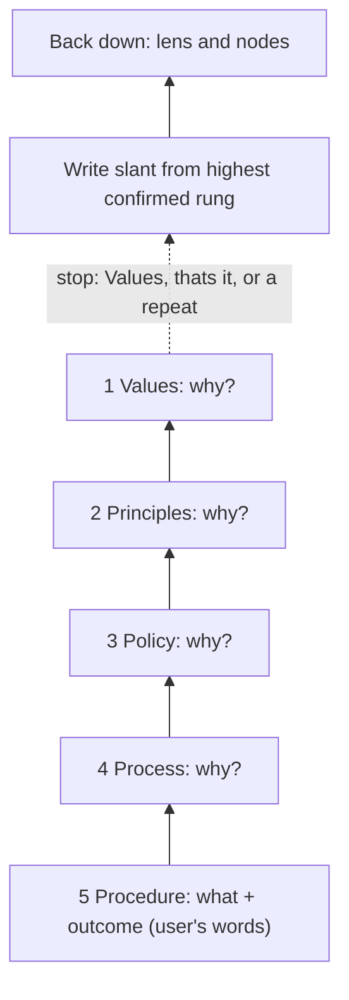

# The slant flow (the why-ladder)

The slant is the angle that best serves the matter (`method/04-slant.md`). The slant flow is how Stage 1 finds it. The what and the outcome sit in the person's own understanding; the reasons for them sit in the levels above.

## The ladder

The spine has five levels. They are called **rungs** here so they are not confused with the layers L1 to L3 in `CONTEXT.md`.

| Rung | Level | Asks |
|---|---|---|
| 5 | Procedure | What do you want done, and what outcome? (the start) |
| 4 | Process | Why: what flow is that part of? |
| 3 | Policy | Why: what rules or choices decide that flow? |
| 2 | Principles | Why: what do you hold to when you choose? |
| 1 | Values | Why: what matters underneath? |

## Steps

1. **Start where the person is.** Ask what they want (the what) and what good looks like (the outcome). This is rung 5. Keep it verbatim.
2. **Ask why, one rung up at a time.** One question per turn. Keep each answer verbatim, in the person's words.
3. **Stop** when any of these is true: the person reaches Values; the person says that's it; an answer repeats the one below.
4. **Write the slant from the highest rung the person confirms.** Propose it as `proposed`. Only the person makes it `confirmed`.
5. **Come back down.** Read the nodes through the slant, rung by rung, so the sixteen Plan and Execute points (the lens) match the person's reasons.

## Where it wires in

- **Stage 1** of `dex.md` runs the flow after the overview and before the vault location questions.
- **`method/04-slant.md`** says what to record: the slant, evidence, what would make it wrong, confidence, status. The ladder answers go in `01_matter/slant.md` as the evidence, verbatim.
- Confirming the slant adapts the vault's open questions (Stage 4, step 1).
- Regulated matters: the ladder still runs, but the slant records "map, never advise" (`method/04-slant.md`).
- Do not answer for the person. If they cannot answer a rung, record that and stop.
